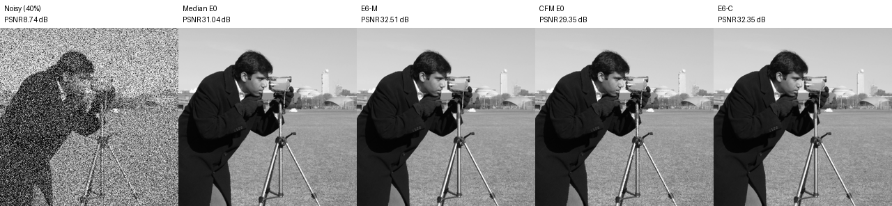
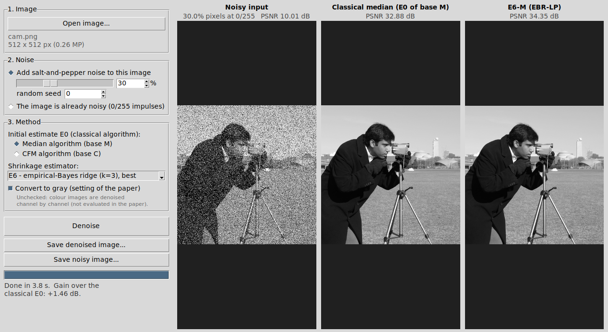

# Shrinkage Denoiser

Desktop app, command-line tool and Python library for removing **salt-and-pepper (impulse) noise** with the
shrinkage estimators **E1-E6** of the accompanying paper. Each estimator *corrects the output of a classical algorithm*
(the median filter or the CFM filter) using a local regression on the clean pixels around every corrupted pixel,
shrunk towards that classical output.


*Camera image, 40 % noise (PSNR in dB). E6 improves both classical outputs: median 31.04 -> 32.51, CFM 29.35 -> 32.35.*

## How it works

For every corrupted pixel (value 0 or 255), the initial estimate **E0** is the output of a classical algorithm
computed on the *clean* pixels of its neighbourhood:

| Base | E0 | 
|------|----|
| **M** | noise-free median |
| **C** | noise-free CFM (certainty-based fuzzy median) |

A bank of 15 predictors is then fitted by regression on the clean pixels of a 19x19 window, and the coefficients are
shrunk towards zero (= E0):

| Estimator | Shrinkage rule |
|-----------|----------------|
| E1 | none (least squares) |
| E2 | James-Stein |
| E3 | grouped James-Stein |
| E4 | ridge, fixed penalty |
| E5 | empirical-Bayes ridge, kappa = 1 |
| **E6** | empirical-Bayes ridge, kappa = 3 (**default, best in the paper**) |

Clean pixels are never modified. Noise is detected blindly as the values 0 and 255.

## Three ways to run it

| Way | For whom | How |
|-----|----------|-----|
| **Web page** (`docs/index.html`) | anyone, nothing to install | open the GitHub Pages link, or double-click `docs/index.html`. Runs in the browser, images are not uploaded. Can be installed as an app from Edge/Chrome (*Install app*). Estimators E1, E4, E5, E6. |
| **Windows installer** | Windows users | download `ShrinkageDenoiser-Setup-*.exe` from the *Releases* page and run it |
| **Python / source** | developers | see below; all estimators E1-E6, CLI and library |

The web page is a JavaScript port of the same algorithm; its output was checked to be pixel-identical to the Python
version (both bases, E1/E4/E5/E6).

### Publishing the web page (GitHub Pages)
*Settings -> Pages -> Build and deployment -> Source: Deploy from a branch -> Branch: `main`, folder `/docs` -> Save.*
The page is then available at `https://<your-name>.github.io/shrinkage-denoiser/`. (Pages for private repositories needs a paid GitHub plan.)

### Building the Windows installer
Push a tag (`git tag v1.0.0 && git push --tags`, or *Releases -> Draft a new release* with tag `v1.0.0`) or run the workflow
*Actions -> windows-installer -> Run workflow*. It builds the app with PyInstaller, self-tests it, packs it with Inno Setup,
and attaches `ShrinkageDenoiser-Setup-<version>.exe` to the release (or to the run as an artifact).
The first launch of the installed app compiles the numerical kernels (about 1 minute); later launches are fast.

## Install from source

Python 3.9+ is required. Tkinter ships with Python on Windows and macOS; on Debian/Ubuntu install it with
`sudo apt install python3-tk`.

```bash
git clone https://github.com/rezaghng/shrinkage-denoiser.git
cd shrinkage-denoiser
pip install -e .
```

## Use

**GUI** (open an image, choose the noise percentage, press *Denoise*):

```bash
shrinkdenoise-gui          # or: python run_gui.py
```



1. *Open image...*
2. Either add synthetic salt-and-pepper noise with the chosen percentage (PSNR against the original is then shown),
   or tick *the image is already noisy* to denoise your own noisy image.
3. Choose the base (median or CFM) and the estimator, then *Denoise*. The middle panel shows the classical algorithm,
   the right panel the shrinkage estimator, so the improvement is visible directly.

**Command line**

```bash
# add 30 % noise, then denoise (prints PSNR)
shrinkdenoise examples/camera.png -o out.png --noise 30 --base C --estimator E6 --gray
# denoise an already noisy image
shrinkdenoise examples/camera_noisy40.png -o out.png
```

**Python**

```python
import numpy as np
from PIL import Image
import shrinkdenoise as sd

img = np.array(Image.open("examples/camera.png"))          # uint8 gray
noisy = sd.add_salt_pepper(img, 0.30, seed=0)
out = sd.denoise(noisy, base="M", estimator="E6")           # base: "M" or "C"
print(sd.psnr(img, out))
```

## Notes and limitations

* **Speed:** about 13-18 s per megapixel after a one-off numba compilation (about 1 min on the very first run, then cached).
  Large images are processed in overlapping tiles, which gives exactly the same result as processing the whole image.
* **Noise model:** the method targets salt-and-pepper noise (values 0/255). It does not handle random-valued impulse noise.
  Images that genuinely contain large areas of pure black or white (0/255) will have those pixels treated as noise.
* **Colour:** the paper works on gray images. Colour images are processed channel by channel when *Convert to gray* is
  unchecked; this extension was not evaluated in the paper.
* Very high noise densities (above about 80 %) leave too few clean pixels; the method then falls back to E0.

## Tests

```bash
pip install -e .[test] && pytest
```

The numerical kernels are copied verbatim from the research code; the outputs were checked to be bit-identical to it.

## Citation

If you use this software, please cite the paper (add the reference here after publication).

## License

MIT, see `LICENSE`.
